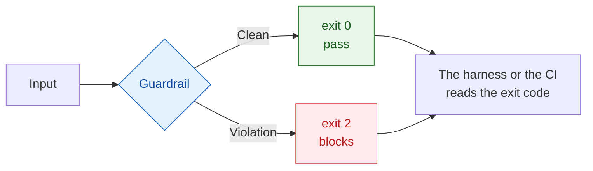

Versión en español: [README.md](README.md)

# guardianes-verificados-ia
### Who guards the guardrails?

[](https://github.com/jleonceo/guardianes-verificados-ia/actions/workflows/ci.yml)

Almost every AI "guardrail" tool checks what comes out of the model. This one checks **the guardrails**. If a detector finds a problem but does not block it, it protects nothing, however well it detects.

The system around a guardrail does not read its text. It reads its **exit code**. A `0` means "clean, let it through". A `2` means "there is a violation, block it". A guardrail that detects the violation but forgets to return the `2` reports green while broken, and nobody finds out.

## What it solves

It puts the guardrails themselves under test: put your guardrail in front of a real violation, does it block it? It checks this by breaking the guardrail on purpose and seeing whether the bank catches it. A guardrail that has never blocked a violation has not shown that it protects against anything.

All of it with the Python standard library. No dependencies, no network, no secrets.

## The hole that slipped past me

I built it and called it done with the bank green. Then an independent check found a hole.

`main()` is the function that turns the verdict into an exit code. Nothing tested it. A mutant that returns `0` there instead of the real code survived without a single alarm going off: the exact failure this repo teaches you to avoid had slipped into the repo itself. I closed it with a bank case that runs `main()` end to end and a mutant that attacks it.

A bank that never fails proves nothing; this one failed when it had to.

## The example: five incidents in red before green

```
python demo_rojo_verde.py
```

It reproduces five real failures. Each one is shown failing first (RED) and then fixed (GREEN):

| # | The incident | The failure | The fix |
|---|---|---|---|
| 1 | The guardrail that did not brake | a shell wrapper swallowed the exit code: a real violation was reported as "passed" | test the guardrail end to end with its wrapper |
| 2 | The verdict without teeth | a health check printed `ENFERMO` and still exited with `0` | tie the verdict to the exit code |
| 3 | The bank that lied | the test cases (copied from the detector's own rules) stayed green with the hole open | add independent cases |
| 4 | The guardrail at the wrong door | a hook watched a name, but the resource could be reached through another door ("we counted five, there were six") | watch the resource instead of the name |
| 5 | The green but blind verdict | a freshness check compared a value with itself: green by construction | compare against an independent source |

Incidents 1, 2 and 5 are miniature versions of dated failures in a real system. Number 4 recreates a real security finding. The names and the data are synthetic.

## How it works inside

**The contract.** A guardrail receives an input and returns an exit code. The harness (or the CI) reads that code and never its text.



**Mutation testing: practising what it preaches.** The repo does not just claim that its bank has teeth: it mutates the guardrails and demands that the bank kills every mutant. A mutant that survives is a hole in the bank and gets reported.

```
python -m guardianes mutar     # → fault-injection 8/8 | source-level 4/4
```

There are two families, counted separately so that no number is inflated. The first (8) injects a fault into a wire of the bank: a blind guardrail, a verdict without teeth, the wrong door. The second (4) is source-level *mutation testing*: it rewrites `guardian_hook.py` with the `ast` module and runs it again (it changes a constant of the contract, negates the detector, swallows the exit code in `main()`). One mutant is left out on purpose: rewriting the slicing of command-line arguments is input/output plumbing. The bank does not cover it.

**The pieces** (one idea per file):

| File | What it does |
|---|---|
| `guardianes/guardian_hook.py` | a guardrail hook that returns `exit 0` or `exit 2` |
| `guardianes/salud_minima.py` | a health orchestrator whose overall verdict really blocks |
| `guardianes/verificador_guardianes.py` | the meta level that enforces the contract end to end |
| `guardianes/guardian_recurso.py` | watches the resource instead of its name |
| `guardianes/guardian_frescura.py` | compares against an independent source |
| `guardianes/banco.py` | a reusable bank, proven in red; each wire is an injection point |
| `guardianes/mutador.py` | behavioural and source mutation testing with `ast` |
| `guardianes/__main__.py` | the command line `verificar · banco · mutar · vigilar` |

## How to use it

```
pip install -e .            # optional; it also runs with plain python
python demo_rojo_verde.py   # the five incidents in red before green
python run_tests.py         # bank + tests in red + mutation score
python -m guardianes verificar "password=secreto"   # exits with 2 (blocks)
python -m guardianes verificar "una linea normal"    # exits with 0 (passes)
```

Every command honours the exit-code contract, so a scheduler or the CI is guided by it and not by the text.

## What already existed (and where it comes from)

It rests on two things it does not invent. **Deterministic hooks** control by code and not by another language model. **Mutation testing** has been saying for half a century that a test that never fails proves nothing. The closest relative validates with a language model; here the validator is code. None of this is new; the repo shows how to combine it.

## How far it goes

This is a minimal harness that demonstrates a method; it does not claim to be a production-ready guardrail library. The guardrails it ships (looking for a secret, comparing a figure) are illustrative: they teach the contract and give something to mutate. They do not replace your security tools. What is reusable is the pattern: the exit-code contract, the bank proven in red and the mutation engine. Swap its guardrails for your own.

## Related repos

This repo is one piece of an ecosystem. The others:

- [`verificacion-determinista-ia`](https://github.com/jleonceo/verificacion-determinista-ia): code that rechecks the coherence of the **data** without AI. The boundary with this repo: that one verifies the data and this one the **guardrails**.
- [`pii-output-gate`](https://github.com/jleonceo/pii-output-gate): an output gate that blocks text carrying personal data. A specific guardrail; here is the harness that examines guardrails like that one.
- [`orquestacion-enjambres-ia`](https://github.com/jleonceo/orquestacion-enjambres-ia): how a system with many agents decides which one handles each request.
- [`agent-memory-governance`](https://github.com/jleonceo/agent-memory-governance): keeping an agent's memory from turning into a junkyard.
- [`gobernanza-skills-analiticas`](https://github.com/jleonceo/gobernanza-skills-analiticas): the method of golden sets and no-regression gates.
