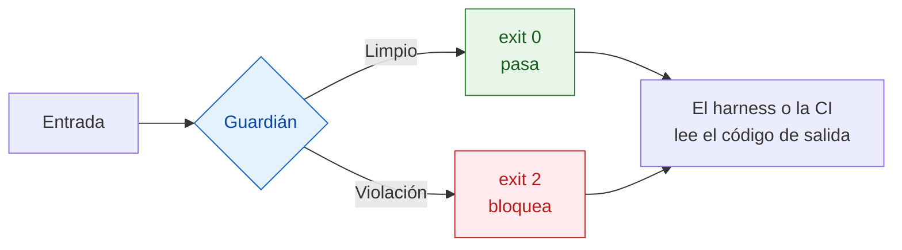

English version: [README.en.md](README.en.md)

# guardianes-verificados-ia
### ¿Quién vigila a los guardianes?

[](https://github.com/jleonceo/guardianes-verificados-ia/actions/workflows/ci.yml)

Casi todas las herramientas de «guardarraíles» para IA comprueban lo que sale del modelo. Esta comprueba **los guardarraíles**. Si un detector encuentra un problema pero no lo bloquea, no protege nada por muy bien que lo detecte.

El sistema que rodea a un guardián no lee su texto. Lee su **código de salida**. Un `0` quiere decir «limpio, pasa». Un `2` quiere decir «hay una violación, bloquéalo». Un guardián que detecta la violación pero se olvida de devolver el `2` canta verde estando roto y nadie se entera.

## Qué resuelve

Pone a examen a los propios guardianes: puesto tu guardián delante de una violación real, ¿la bloquea? Lo comprueba rompiéndolo a propósito y viendo si el banco lo caza. Un guardián que nunca ha bloqueado una violación no ha demostrado proteger de nada.

Todo con la biblioteca estándar de Python. Sin dependencias, sin red, sin secretos.

## El agujero que se me coló a mí

Lo construí y lo di por bueno con el banco en verde. Luego una comprobación independiente encontró un agujero.

`main()` es la función que convierte el veredicto en código de salida. No la probaba nada. Un mutante que ahí devuelve `0` en lugar del código real sobrevivía sin que saltara ninguna alarma: el fallo exacto que este repo enseña a evitar se me había colado en el propio repo. Lo tapé con un caso de banco que ejecuta `main()` de punta a punta y un mutante que lo ataca.

Un banco que nunca falla no demuestra nada; este falló cuando tenía que fallar.

## El ejemplo: cinco incidentes en rojo antes que en verde

```
python demo_rojo_verde.py
```

Reproduce cinco fallos reales. Cada uno se enseña primero fallando (ROJO) y luego arreglado (VERDE):

| # | El incidente | El fallo | El arreglo |
|---|---|---|---|
| 1 | El guardián que no frenaba | un envoltorio de shell se tragaba el código de salida: una violación real se reportaba como «pasada» | comprobar el guardián de punta a punta con su envoltorio |
| 2 | El veredicto sin dientes | una comprobación de salud imprimía `ENFERMO` y aun así salía con `0` | atar el veredicto al código de salida |
| 3 | El banco que mentía | los casos de prueba (copiados de las reglas del propio detector) quedaban en verde con el agujero abierto | añadir casos independientes |
| 4 | El guardián en la puerta equivocada | un hook vigilaba un nombre, pero al recurso se llegaba por otra puerta («contamos cinco, había seis») | vigilar el recurso en vez del nombre |
| 5 | El veredicto verde pero ciego | una comprobación de frescura comparaba un valor consigo mismo: verde por construcción | comparar contra una fuente independiente |

Los incidentes 1, 2 y 5 son versiones en miniatura de fallos con fecha de un sistema real. El 4 recrea un hallazgo de seguridad real. Los nombres y los datos son sintéticos.

## Cómo funciona por dentro

**El contrato.** Un guardián recibe una entrada y devuelve un código de salida. El harness (o la CI) lee ese código y nunca su texto.



**Mutation testing: que practique lo que predica.** El repo no se limita a decir que su banco tiene dientes: muta los guardianes y exige que el banco mate a cada mutante. Un mutante que sobrevive es un agujero del banco y se reporta.

```
python -m guardianes mutar     # → fault-injection 8/8 | source-level 4/4
```

Hay dos familias y se cuentan por separado para que ningún número quede inflado. La primera (8) inyecta un fallo en un cable del banco: un guardián ciego, un veredicto sin dientes, la puerta equivocada. La segunda (4) es *mutation testing* de fuente de verdad: reescribe `guardian_hook.py` con el módulo `ast` y lo vuelve a ejecutar (cambia una constante del contrato, niega el detector, se traga el código de salida en `main()`). Un mutante se queda fuera a propósito: reescribir el troceo de argumentos de la línea de comandos es fontanería de entrada/salida y el banco no la cubre.

**Las piezas** (una idea por fichero):

| Fichero | Qué hace |
|---|---|
| `guardianes/guardian_hook.py` | un hook guardián que devuelve `exit 0` o `exit 2` |
| `guardianes/salud_minima.py` | un orquestador de salud cuyo veredicto global bloquea de verdad |
| `guardianes/verificador_guardianes.py` | el nivel meta que exige el contrato de punta a punta |
| `guardianes/guardian_recurso.py` | vigila el recurso en vez de su nombre |
| `guardianes/guardian_frescura.py` | compara contra una fuente independiente |
| `guardianes/banco.py` | un banco reutilizable y probado en rojo; cada cable es un punto de inyección |
| `guardianes/mutador.py` | mutation testing de comportamiento y de fuente con `ast` |
| `guardianes/__main__.py` | la línea de comandos `verificar · banco · mutar · vigilar` |

## Cómo se usa

```
pip install -e .            # opcional; también se ejecuta con python a secas
python demo_rojo_verde.py   # los cinco incidentes en rojo antes que verde
python run_tests.py         # banco + pruebas en rojo + score de mutación
python -m guardianes verificar "password=secreto"   # sale con 2 (bloquea)
python -m guardianes verificar "una linea normal"    # sale con 0 (pasa)
```

Todos los comandos respetan el contrato del código de salida, así que un planificador o la CI se guían por él y no por el texto.

## Lo que ya había (y de dónde viene)

Se apoya en dos cosas que no inventa. Los **hooks deterministas** controlan por código y no por otro modelo de lenguaje. El **mutation testing** lleva medio siglo diciendo que un test que nunca falla no prueba nada. El pariente más cercano valida con un modelo de lenguaje; aquí el validador es código. Nada de esto es nuevo; el repo enseña a combinarlo.

## Hasta dónde llega

Esto es un harness mínimo que demuestra un método; no pretende ser una librería de guardarraíles lista para producción. Los guardianes que trae (buscar un secreto, comparar una cifra) son ilustrativos: enseñan el contrato y dan algo que mutar. No sustituyen a tus herramientas de seguridad. Lo que sí es reutilizable es el patrón: el contrato del código de salida, el banco probado en rojo y el motor de mutación. Cámbiale los guardianes por los tuyos.

## Repos relacionados

Este repo es una pieza de un ecosistema. Los demás:

- [`verificacion-determinista-ia`](https://github.com/jleonceo/verificacion-determinista-ia): código que recomprueba la coherencia de los **datos** sin IA. La frontera con este repo: aquel verifica los datos y este a los **guardianes**.
- [`pii-output-gate`](https://github.com/jleonceo/pii-output-gate): una puerta de salida que bloquea el texto con datos personales. Un guardián concreto; aquí está el harness que examina a guardianes como ese.
- [`orquestacion-enjambres-ia`](https://github.com/jleonceo/orquestacion-enjambres-ia): cómo un sistema con muchos agentes decide a cuál mandar cada petición.
- [`agent-memory-governance`](https://github.com/jleonceo/agent-memory-governance): que la memoria de un agente no se vuelva un vertedero.
- [`gobernanza-skills-analiticas`](https://github.com/jleonceo/gobernanza-skills-analiticas): el método de golden sets y puertas de no-regresión.

